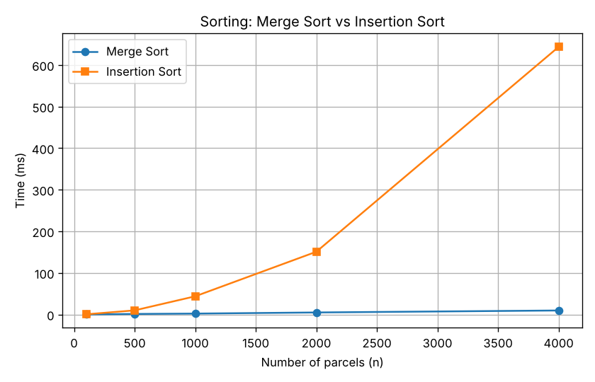
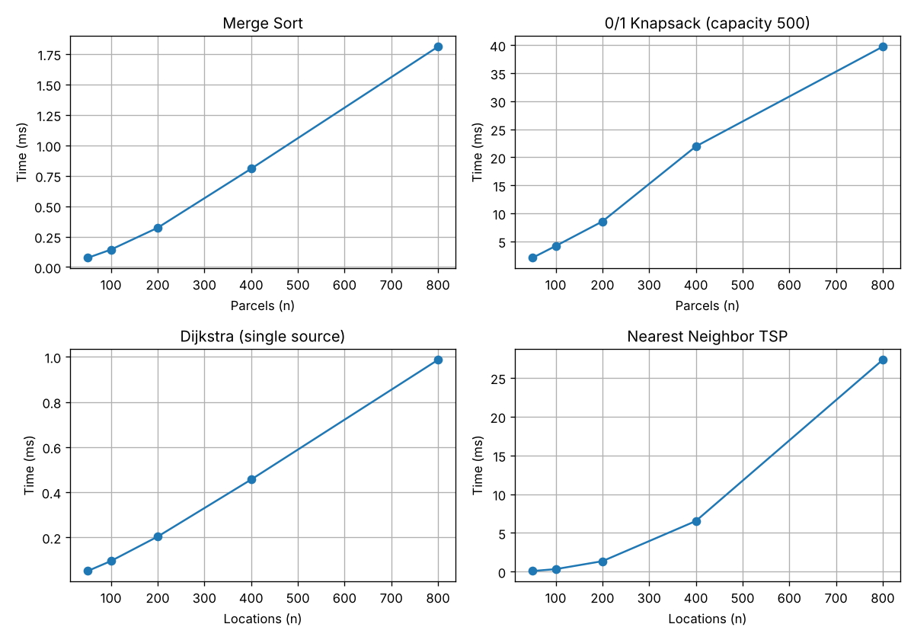
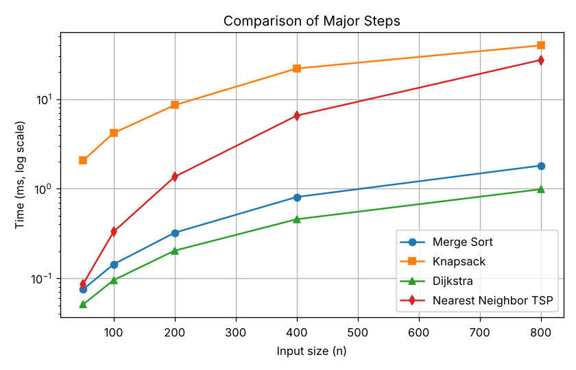

# Mini-Courier Planner - Project Report

**Course:** Design & Analysis of Algorithms (ETCCDA302)
**Programme:** B.Tech CSE
**Assignment:** Capstone Assignment - Mini-Courier Planner

---

## 1. Project Overview and Objectives

Mini-Courier Planner is a prototype of a courier planning system. Given a list of parcels and a road network, it decides which parcels to load for one trip and in what order to visit the delivery locations.

Objectives:

1. Sort parcels by delivery priority and deadline.
2. Choose the most valuable set of parcels that fits in the vehicle (Dynamic Programming).
3. Represent delivery locations as a weighted graph and find shortest paths (Dijkstra).
4. Build a full delivery route that visits every location and returns to the depot (Nearest Neighbor TSP approximation).
5. Measure the runtime of each major step on different input sizes and compare them.

All five parts are connected through one menu-driven program (`main.py`).

## 2. Problem Definition

A courier vehicle starts at a depot with a fixed weight capacity. There are more parcels waiting than the vehicle can carry. Each parcel has a destination, weight, priority, deadline and delivery value.

**Input:** parcels, road network (locations and distances), vehicle capacity, depot name.
**Output:** the parcels to load, the delivery route starting and ending at the depot, and the total route distance.

Problem breakdown:

| Sub-problem | Technique |
| --- | --- |
| Which parcels come first? | Sorting |
| Which parcels should be loaded? | 0/1 Knapsack (DP) |
| How far is one place from another? | Dijkstra's shortest path |
| In what order should places be visited? | Nearest Neighbor (TSP approximation) |
| Is it fast enough for bigger inputs? | Runtime measurement |

Assumptions: one vehicle, one trip, roads are two-way, weights and distances are whole numbers, priority 1 is the highest. Priority and deadline are used for sorting; the knapsack maximizes the delivery value of the loaded parcels.

## 3. Design (Phase 1)

### 3.1 Data design

**Parcel** (one row in `parcels.csv`):

| Field | Meaning |
| --- | --- |
| parcel_id | unique id such as P01 |
| destination | delivery location name |
| weight | weight in kg (positive integer) |
| priority | 1 (high), 2 (medium), 3 (low) |
| deadline | hours from now |
| value | delivery value in Rs |

**Graph** (`roads.csv`): each row is a two-way road `location_a, location_b, distance`. The graph is stored as an adjacency dictionary:

```
graph["Depot"] = {"Palam": 7, "Janakpuri": 9, "Rajouri Garden": 12}
```

**Vehicle** (`vehicle.json`): capacity in kg and the depot name.

### 3.2 System workflow

```
 parcels.csv, roads.csv, vehicle.json
                  |
                  v
          data_loader.py  (load + check data)
                  |
      +-----------+-----------------+
      |                             |
      v                             v
 Merge Sort                    Build graph
 (priority, deadline)          (adjacency dictionary)
      |                             |
      v                             v
 0/1 Knapsack  -- selected --> Dijkstra from every stop
 (capacity)       parcels       (distance matrix)
                                    |
                                    v
                            Nearest Neighbor TSP
                            (route + total distance)
                                    |
                                    v
                            Final delivery summary
```

Why these techniques fit:

- Sorting gives a clear order for handling urgent parcels.
- Knapsack is the standard model for "choose items under a weight limit to maximize value".
- Roads form a weighted graph with non-negative distances, so Dijkstra gives exact shortest paths.
- Visiting every stop once and returning is the Travelling Salesman Problem. It is NP-hard, so a fast approximation (Nearest Neighbor) is used.

### 3.3 Mapping to assignment phases

| Phase | Where it is done |
| --- | --- |
| Phase 1 - Design and planning | This section, data files in `data/` |
| Phase 2 - Prioritization and box filling | `sorting.py`, `knapsack.py`, menu options 2 and 3 |
| Phase 3 - Route maker and graph processing | `graph.py`, `tsp.py`, menu options 4, 5, 6 |
| Phase 4 - Performance testing | `performance.py`, `tests.py`, menu option 8, `results/` |
| Phase 5 - Report and demonstration | this report, `README.md`, `results/screenshots/` |

## 4. Algorithms

### 4.1 Merge Sort (`sorting.py`)

Parcels are compared using the pair `(priority, deadline)`, so priority 1 parcels come first and, within the same priority, the earliest deadline comes first.

Working: split the list into two halves, sort each half recursively, then merge the two sorted halves by repeatedly taking the smaller front element.

Why merge sort: it always takes O(n log n) time and it is stable (parcels with equal priority and deadline keep their original order). Insertion sort is also implemented only so that the two can be compared in the performance analysis.

### 4.2 0/1 Knapsack (`knapsack.py`)

Let `table[i][w]` be the best total value using the first `i` parcels with capacity `w`.

```
table[i][w] = table[i-1][w]                                   if weight_i > w
table[i][w] = max(table[i-1][w], table[i-1][w-weight_i] + value_i)   otherwise
```

Row 0 and column 0 are all 0. The answer is `table[n][capacity]`. To find which parcels were chosen, start from `table[n][capacity]` and go upward: if `table[i][w] != table[i-1][w]`, parcel `i` was taken, so reduce `w` by its weight. "0/1" means each parcel is either taken completely or not at all.

### 4.3 Graph and Dijkstra (`graph.py`)

Dijkstra finds the shortest distance from one source to every other location.

1. Set the distance of the source to 0 and all others to infinity.
2. Take the unvisited location with the smallest distance (a min-heap from Python's `heapq` is used).
3. For each neighbor, if `distance[current] + road` is smaller than the stored distance, update it and remember the previous location.
4. Repeat until the heap is empty.

The `previous` dictionary is followed backwards to rebuild the actual road path. Locations that cannot be reached keep the distance infinity.

### 4.4 Nearest Neighbor TSP (`tsp.py`)

1. Run Dijkstra from the depot and from every delivery location to build a distance matrix of shortest road distances.
2. Start at the depot.
3. Repeatedly go to the nearest location not yet visited.
4. When all are visited, return to the depot and add that last distance.

This is a greedy approximation. It is fast but not optimal; it can make a poor choice early and be forced into a long trip at the end (visible in the large dataset, where the last two legs are 62 km and 99 km).

## 5. Time and Space Complexity

n = number of parcels, W = vehicle capacity, V = locations, E = roads, k = delivery locations on the route.

| Algorithm | Time | Space |
| --- | --- | --- |
| Merge Sort | O(n log n) in best, average and worst case | O(n) |
| Insertion Sort (for comparison) | O(n^2) worst/average, O(n) best | O(1) extra (O(n) with the copy made in this code) |
| 0/1 Knapsack (DP) | O(n x W) | O(n x W) - the whole table is kept to find the selected parcels |
| Dijkstra (binary heap) | O((V + E) log V) | O(V + E) |
| Distance matrix (Dijkstra from k+1 places) | O(k x (V + E) log V) | O(k^2) |
| Nearest Neighbor TSP | O(k^2) | O(k) extra (plus the matrix) |

Note: Knapsack is "pseudo-polynomial" because its time depends on the numeric value of W, not only on the number of parcels.

## 6. Sample Input and Output (small dataset)

Real output from `python main.py` (dataset 1).

**Input parcels** (`data/small/parcels.csv`, vehicle capacity 30 kg):

```
ID    Destination         Weight(kg)  Priority  Deadline(h)  Value(Rs)
P01   Dwarka                       8         1            6         90
P02   Palam                        5         2           12         50
P03   Janakpuri                   12         3           48         40
P04   Uttam Nagar                  6         1            8         80
P05   Najafgarh                   10         2           24         55
P06   Vikaspuri                    4         3           36         25
P07   Rajouri Garden               7         1           10         85
P08   Tilak Nagar                  9         2           20         60
P09   Dwarka                       3         3           30         20
P10   Janakpuri                    6         2           16         45
P11   Palam                       11         3           40         35
P12   Najafgarh                    5         1            9         70
```

**After sorting (option 2):** P01, P04, P12, P07 (priority 1 by deadline), then P02, P10, P08, P05 (priority 2), then P09, P06, P11, P03 (priority 3).

**Knapsack result (option 3):**

```
Selected: P01, P04, P12, P07, P06
Weight loaded: 30 kg | Remaining space: 0 kg
Maximum total value (DP table result): Rs 350
Capacity check: OK
```

The full DP table is printed by the program (see `results/screenshots/02_knapsack_selection.png`).

**Shortest paths from the Depot (option 5):**

```
Destination        Distance(km)   Path
Palam                         7   Depot -> Palam
Janakpuri                     9   Depot -> Janakpuri
Rajouri Garden               12   Depot -> Rajouri Garden
Dwarka                       12   Depot -> Palam -> Dwarka
Najafgarh                    22   Depot -> Palam -> Najafgarh
Uttam Nagar                  13   Depot -> Janakpuri -> Uttam Nagar
Vikaspuri                    12   Depot -> Janakpuri -> Vikaspuri
Tilak Nagar                  14   Depot -> Janakpuri -> Tilak Nagar
```

**Route and summary (options 6 and 7):**

```
Stop  Location          Parcels                 Leg(km)  Total(km)
1     Dwarka            P01                          12         12
2     Uttam Nagar       P04                           6         18
3     Vikaspuri         P06                           5         23
4     Rajouri Garden    P07                           6         29
5     Najafgarh         P12                          21         50
6     Depot             (return to depot)            22         72

Route: Depot -> Dwarka -> Uttam Nagar -> Vikaspuri -> Rajouri Garden -> Najafgarh -> Depot
Total route distance: 72 km
Parcels left for the next trip (7): P02, P10, P08, P05, P09, P11, P03
```

Hand check of the route: Depot to Dwarka is 7 + 5 = 12 km; Dwarka to Uttam Nagar 6; Uttam Nagar to Vikaspuri 5; Vikaspuri to Rajouri Garden 6; Rajouri Garden to Najafgarh is 6 + 5 + 10 = 21; Najafgarh to Depot is 15 + 7 = 22. Total = 12 + 6 + 5 + 6 + 21 + 22 = 72 km.

**Large dataset** (60 parcels, 21 locations, capacity 120 kg): the knapsack loads 28 parcels (120 kg, Rs 1755) going to 14 locations, and the Nearest Neighbor route is 306 km (`results/screenshots/05_large_dataset_summary.png`).

## 7. Testing and Verification

`python tests.py` runs 47 checks. Result of the final run (`results/test_results.txt`):

```
Total tests: 47 | Passed: 47 | Failed: 0
```

| Area | What was checked |
| --- | --- |
| Sorting | Same result as Python's `sorted()` on random lists (merge and insertion sort); empty list; one parcel; equal keys stay in original order; input list not modified; reverse-sorted input |
| Knapsack | Same best value as brute force over all subsets on 40 random cases; selected weight never above capacity; selected values add up to the DP value; textbook example (answer 9); capacity 0; all parcels too heavy; all parcels fit; no parcels; both datasets stay within capacity |
| Dijkstra | Hand-worked graph; same distances as Floyd-Warshall on 15 random graphs from every source; path length equals reported distance; unreachable location gives infinity and an empty path; known distances in the sample dataset; large dataset checked against Floyd-Warshall |
| Nearest Neighbor | Hand-worked 4-place example (19); no places; one place; duplicate places; route distance equals the sum of its legs; never shorter than the brute-force optimum on 20 random cases |
| Full pipeline | On both datasets: route starts and ends at the depot, every destination of the selected parcels is visited exactly once, total distance = sum of legs = real road distance, weight within capacity; bad data (unknown destination, zero weight) is rejected |

Menu input handling was also tested: invalid menu numbers, invalid location numbers, running option 6 or 7 before option 3.

## 8. Performance Analysis (Phase 4)

`performance.py` (menu option 8) generates random parcels, graphs and distance matrices (fixed random seed, so the inputs are the same each time). Each time below is the average of 5 runs measured with `time.perf_counter()`. These values were measured on the machine used for testing; absolute times will differ on another computer, but the growth pattern stays the same.

**Sorting: Merge Sort vs Insertion Sort (time in ms)**

| n | Merge Sort | Insertion Sort |
| --- | --- | --- |
| 100 | 0.1547 | 0.4086 |
| 500 | 1.2092 | 9.8198 |
| 1000 | 2.0864 | 43.6673 |
| 2000 | 4.7974 | 150.8524 |
| 4000 | 9.5572 | 643.5507 |



**Major steps (time in ms)**

| n | Merge Sort | Knapsack (W = 500) | Dijkstra (one source) | Nearest Neighbor TSP |
| --- | --- | --- | --- | --- |
| 50 | 0.0751 | 2.0575 | 0.0510 | 0.0860 |
| 100 | 0.1432 | 4.1813 | 0.0954 | 0.3304 |
| 200 | 0.3226 | 8.5577 | 0.2035 | 1.3568 |
| 400 | 0.8077 | 21.9410 | 0.4562 | 6.5367 |
| 800 | 1.8104 | 39.7272 | 0.9866 | 27.3320 |





What the results show:

- Insertion sort grows roughly with n squared: from n = 2000 to 4000 its time grows about 4.3 times, while merge sort grows about 2 times (n log n). At n = 4000 merge sort is about 67 times faster.
- Merge Sort and Dijkstra grow almost linearly in this range (n log n and (V + E) log V). Doubling n roughly doubles the time.
- Knapsack is the most expensive step because it fills n x W cells. With W fixed at 500, its time grows about linearly with n; it would also grow with W.
- Nearest Neighbor time grows with the square of the number of locations: doubling from 400 to 800 multiplies the time by about 4.2. In the real pipeline the cost of building the distance matrix (many Dijkstra runs) is added to this.

Optimization comments:

- Knapsack can use a single 1-D array if only the best value is needed (space O(W)), but the full table is kept here so the selected parcels can be traced back and shown.
- The Nearest Neighbor search can be sped up with a priority structure, but for a single vehicle with a small number of stops it is already fast.
- Route quality (not speed) is the main weakness of Nearest Neighbor; see future improvements.

## 9. Observations and Limitations

- Knapsack maximizes total value and does not look at priority directly. In the large dataset it loads 13 of 19 priority-1 parcels; 6 priority-1 parcels are left for the next trip because lower-value combinations fit better. Priority is therefore only reflected through the parcel values and the sorting order.
- Nearest Neighbor does not give the shortest possible tour. The tests confirm it is never shorter than the brute-force optimum. In a separate check with 20 random cases of 5 stops each, it was longer than the optimal tour in 11 cases.
- Deadlines are used for ordering parcels; the route does not check whether each deadline is met.
- The prototype plans one trip for one vehicle.

## 10. Possible Future Improvements

1. Plan several trips automatically until all parcels are delivered.
2. Improve the route with 2-opt or use a better approximation such as Christofides.
3. Check deadlines against estimated travel time and penalize late deliveries.
4. Add priority as a constraint or a bonus in the knapsack value.
5. Support several vehicles with different capacities.
6. Use real map distances and traffic data.
7. Add a graphical interface and a map view of the route.

## 11. How to Run

```
pip install matplotlib
python main.py
python tests.py
```

See `README.md` for the full instructions and folder structure.

## 12. Evidence Files

| File | Content |
| --- | --- |
| `results/screenshots/01_parcels_and_sorting.png` | Options 1 and 2 |
| `results/screenshots/02_knapsack_selection.png` | Option 3 with DP table |
| `results/screenshots/03_graph_and_dijkstra.png` | Options 4 and 5 |
| `results/screenshots/04_route_and_summary.png` | Options 3, 6 and 7 (small dataset) |
| `results/screenshots/05_large_dataset_summary.png` | Large dataset run |
| `results/screenshots/06_test_results.png` | Test run |
| `results/runtime_results.csv`, `results/performance_output.txt` | Measured runtimes |
| `results/*.png` | Runtime charts |
| `results/test_results.txt` | Test output |

The screenshots are images of the actual console output of the program (captured by running it), not edited results.
